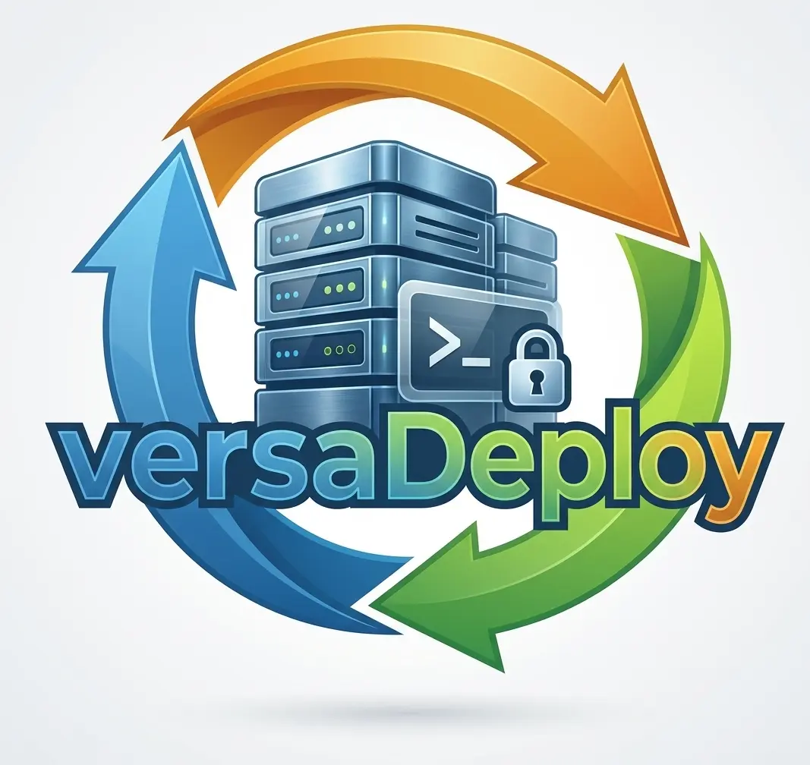

<p align="center">
  
</p>

<p align="center">
  Atomic, incremental deployments from your machine (Windows, Linux, macOS) or CI to Linux servers over SSH.
</p>

<p align="center">
  <a href="https://github.com/kriollo/versaDeploy/releases"></a>
  <a href="https://github.com/kriollo/versaDeploy/actions/workflows/test.yml"></a>
  <a href="LICENSE"></a>
  <a href="https://deepwiki.com/kriollo/versaDeploy"></a>
</p>

versaDeploy builds your project locally (PHP/Composer, Node frontends, Go, Python), uploads only what changed, and switches the server to the new release with one symlink. If a hook or the health check fails after the switch, it rolls back on its own.

```bash
versa deploy production
```

## How a deploy works

1. **Detect** — SHA256 of every file against the last deploy. Builders run only for the languages that changed.
2. **Build** — locally, off the server: PHP, frontend, Go and Python.
3. **Upload** — parallel SFTP, in chunks. Optional incremental upload; `vendor`, `node_modules` and `.venv` are reused with hardlinks.
4. **Activate** — hooks, an atomic `current` symlink, service restart and a health check. A failure rolls the symlink back.

## Features

- **Atomic releases and instant rollback.** Each deploy is a new directory; `versa rollback` switches `current` back in one step.
- **Safe by default.** Deploys only committed code, one deploy at a time (remote lock), and verifies the SSH host key. Build artifacts and secrets stay private on both ends, root never runs a file the deploy user can write, and self-update only installs a checksum-verified GitHub release.
- **Go, Python and Node services (Next.js, Nuxt and other SSR apps).** The binary, Python or Node server runs through systemd, or OpenRC / SysV init on old servers. It starts at boot, restarts on every deploy and rollback, and the release rolls back if it does not stay up. Python virtualenvs (and, with `server_install`, `node_modules`) are built on the server.
- **Hooks, reloads and checks.** Local and remote hooks, service reloads (PHP-FPM, Nginx…), HTTP or command health checks, Slack/Teams/Discord webhooks.
- **Old servers included.** POSIX-only remote commands, and legacy SSH algorithms for OpenSSH &lt; 7 (CentOS 5/6).
- **Local mode** for hosting without SSH: a complete release folder you can upload by FTP.
- **Interactive TUI.** Run `versa` to browse releases and server files, deploy, roll back and open a remote terminal. Works with the keyboard and the mouse (tabs, environments, wheel).
- **Server setup included.** The TUI *Services* view detects and installs the stack (nginx/Apache, PHP, PostgreSQL/MySQL, Redis or Dragonfly, Python, Node, SSL, firewall, cron jobs, deploy user) on **Debian/Ubuntu and RHEL/Rocky/Alma**, applies security updates, shows logs and schedules DB backups — agentless, over SSH, and safe on servers already in use.

## Install

Download the binary for your OS from [Releases](https://github.com/kriollo/versaDeploy/releases/latest), put it in your `PATH`, and check:

```bash
versa version
```

Details for each OS: [INSTALL.md](doc/INSTALL.md). Update later with `versa self-update`.

## Quick start

```bash
cd my-project
versa init                                  # creates deploy.yml
versa config validate production            # check the file
versa info production                       # check SSH and the server
versa deploy production --initial-deploy    # first deploy
versa deploy production                     # every deploy after that
```

## Documentation

| Document | Read it when… |
| --- | --- |
| [Getting Started](doc/GETTING_STARTED.md) | You are preparing a server and a project for the first time. |
| [Quick Start](doc/QUICKSTART.md) | You already have SSH and want the five-minute version. |
| [CLI Reference](doc/CLI_REFERENCE.md) | You want a command, a flag, or a TUI shortcut. |
| [Configuration Reference](doc/DEPLOY.md) | You are writing or changing `deploy.yml`. |
| [Services view](doc/SERVICES.md) | You want versa to set up and maintain the server. |
| [Troubleshooting](doc/TROUBLESHOOTING.md) | Something failed. |
| [Changelog](CHANGELOG.md) | You want to know what changed between versions. |

## License

[MIT](LICENSE)
