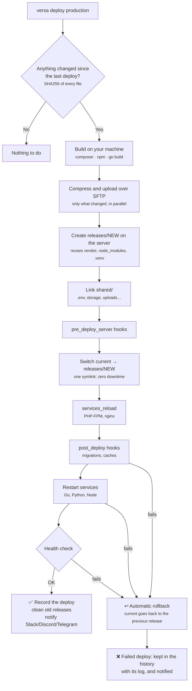
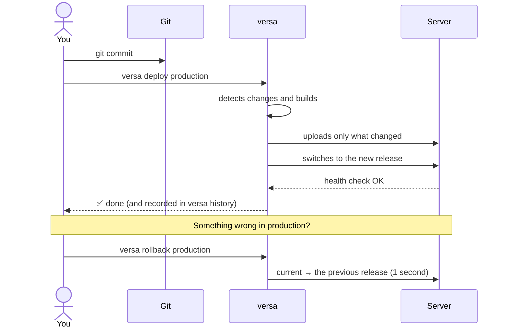
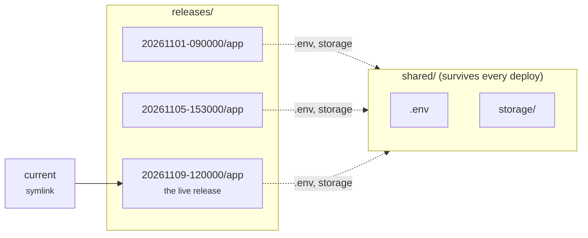
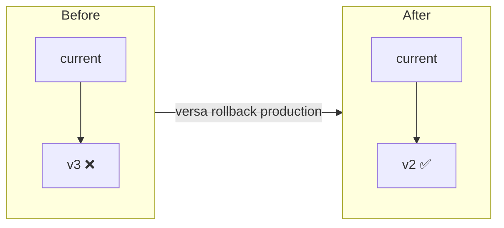
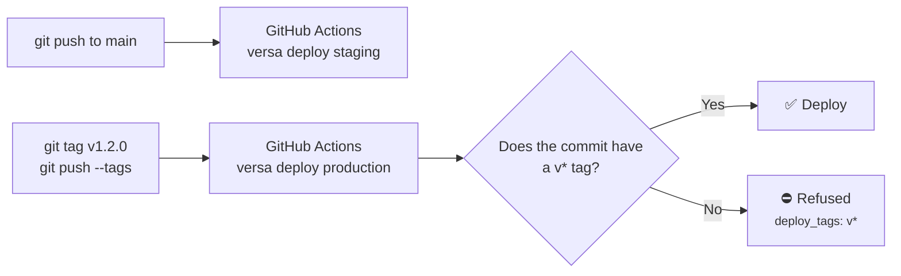
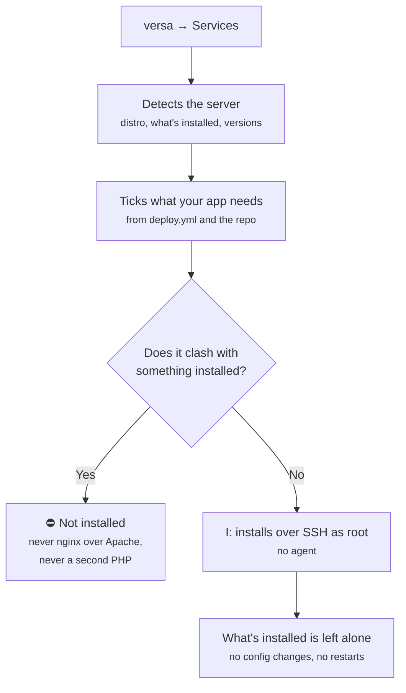

# How it works

What versaDeploy does under the hood, as diagrams. Every step is detailed in the [reference](reference/DEPLOY.md).

## What `versa deploy` does

The heavy lifting happens on **your machine** (or in CI); the server only receives the result and switches to it.

## First deploy to a new server

Step by step in [Getting started](start.md), and on video in [Videos](videos.md).

## Every day

## Where things live on the server

- Your **production `.env`** lives only in `shared/`: it never goes through git or your machine. The first deploy creates it from `.env.example`; you edit it in the TUI's **Shared** view.
- Every release links the same `.env`; rolling back doesn't change it.
- The last `releases_to_keep` releases (5 by default) are kept: those are the ones a rollback can go back to.

## Rollback

Nothing is built or uploaded again: the previous release is still on the server, and versa only moves the link, reloads PHP-FPM/nginx and restarts the services. The same happens by itself when a deploy fails after switching.

## Staging, production and CI

Each environment has its own server (or its own `remote_path`) and its own `.env`. With `deploy_tags: "v*"`, production only accepts tagged versions, even from someone's laptop. The example workflow is [examples/github-actions.yml](https://github.com/kriollo/versaDeploy/blob/main/examples/github-actions.yml).

## The Services view (provisioning)

Details in [Server services](reference/SERVICES.md).
