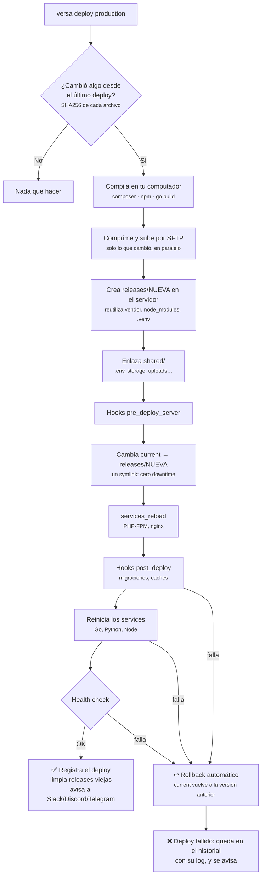
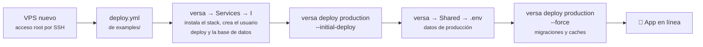
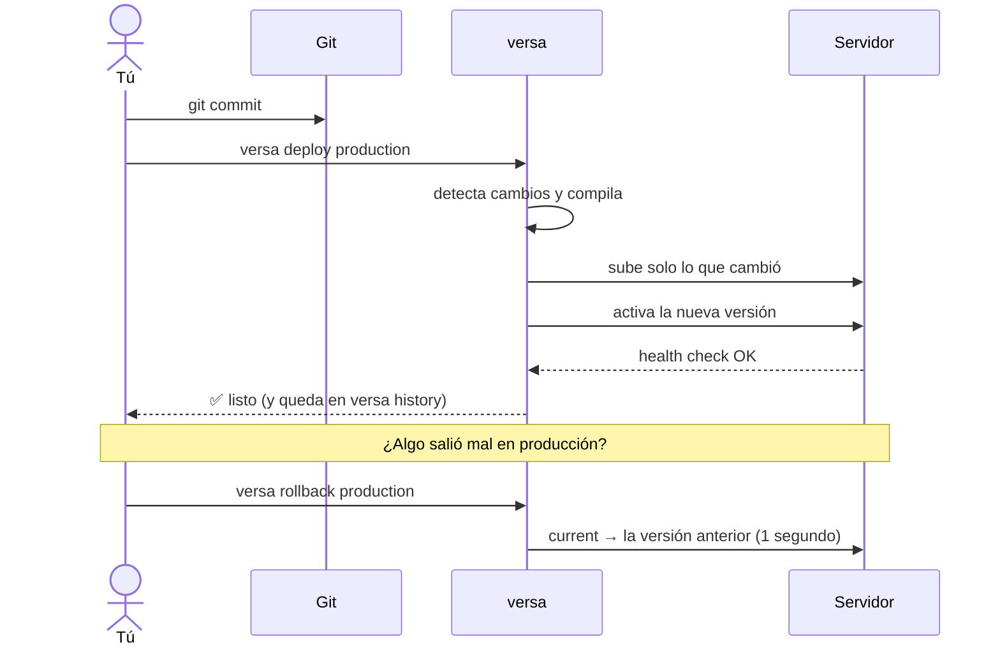
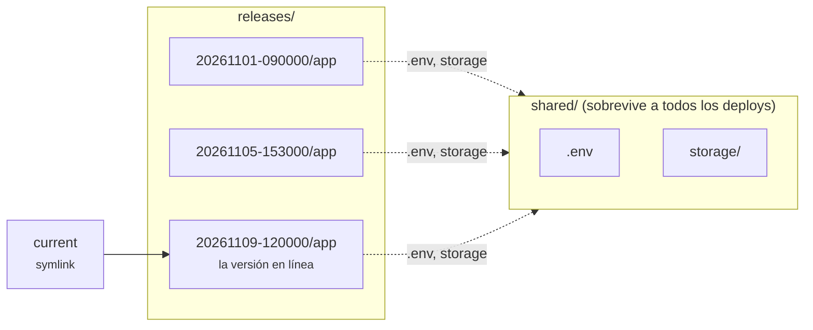
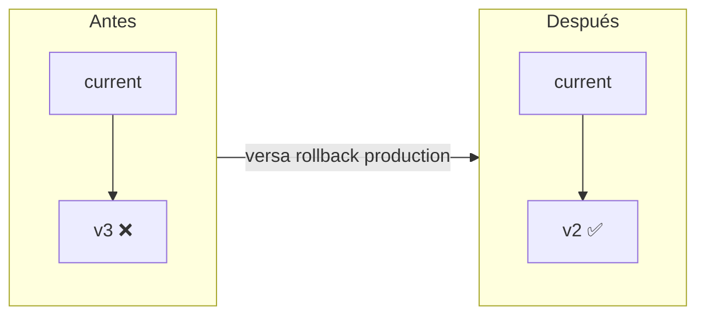
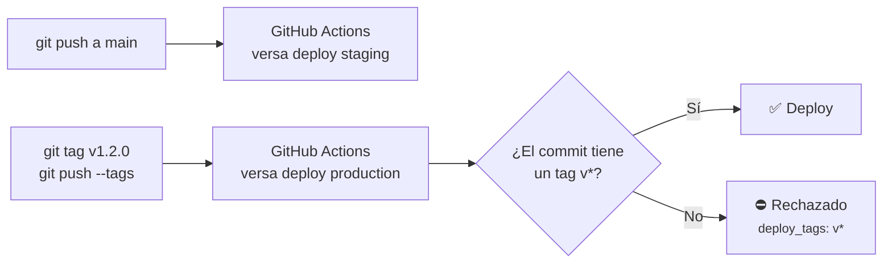
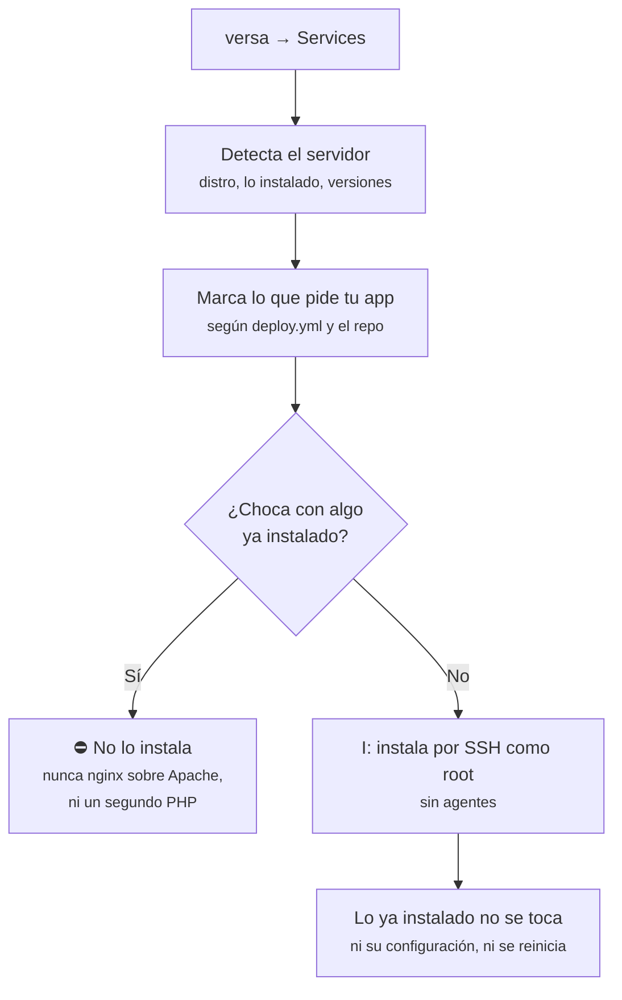

# Flujos

Cómo funciona versaDeploy por dentro, en diagramas. Para cada paso hay más detalle en la [referencia](reference/DEPLOY.md).

## Qué hace `versa deploy`

Todo lo pesado ocurre en **tu computador** (o en el CI); el servidor solo recibe el resultado y lo activa.

## Primer deploy en un servidor nuevo

Paso a paso en [Primeros pasos](start.md), y en video en [Videos](videos.md).

## El día a día

## Dónde vive cada cosa en el servidor

- Tu **`.env` de producción** vive solo en `shared/`: nunca pasa por git ni por tu computador. Se crea en el primer deploy a partir de `.env.example` y se edita desde la vista **Shared** de la TUI.
- Cada versión enlaza el mismo `.env`; volver atrás no lo cambia.
- Se guardan las últimas `releases_to_keep` versiones (5 por defecto): son las que puedes recuperar con un rollback.

## Rollback

No se vuelve a compilar ni a subir nada: el código de la versión anterior sigue en el servidor, y versa solo mueve el enlace, recarga PHP-FPM/nginx y reinicia los services. Lo mismo ocurre solo cuando un deploy falla después de activarse.

## Staging, producción y CI

Cada entorno tiene su propio servidor (o su propio `remote_path`) y su propio `.env`. Con `deploy_tags: "v*"`, producción solo acepta versiones con tag, aunque alguien lo intente desde su computador. El workflow de ejemplo está en [examples/github-actions.yml](https://github.com/kriollo/versaDeploy/blob/main/examples/github-actions.yml). El [video de GitHub Actions](videos.md#github-actions) lo arma paso a paso.

## La vista Services (provisioning)

Detalles en [Servicios del servidor](reference/SERVICES.md).
