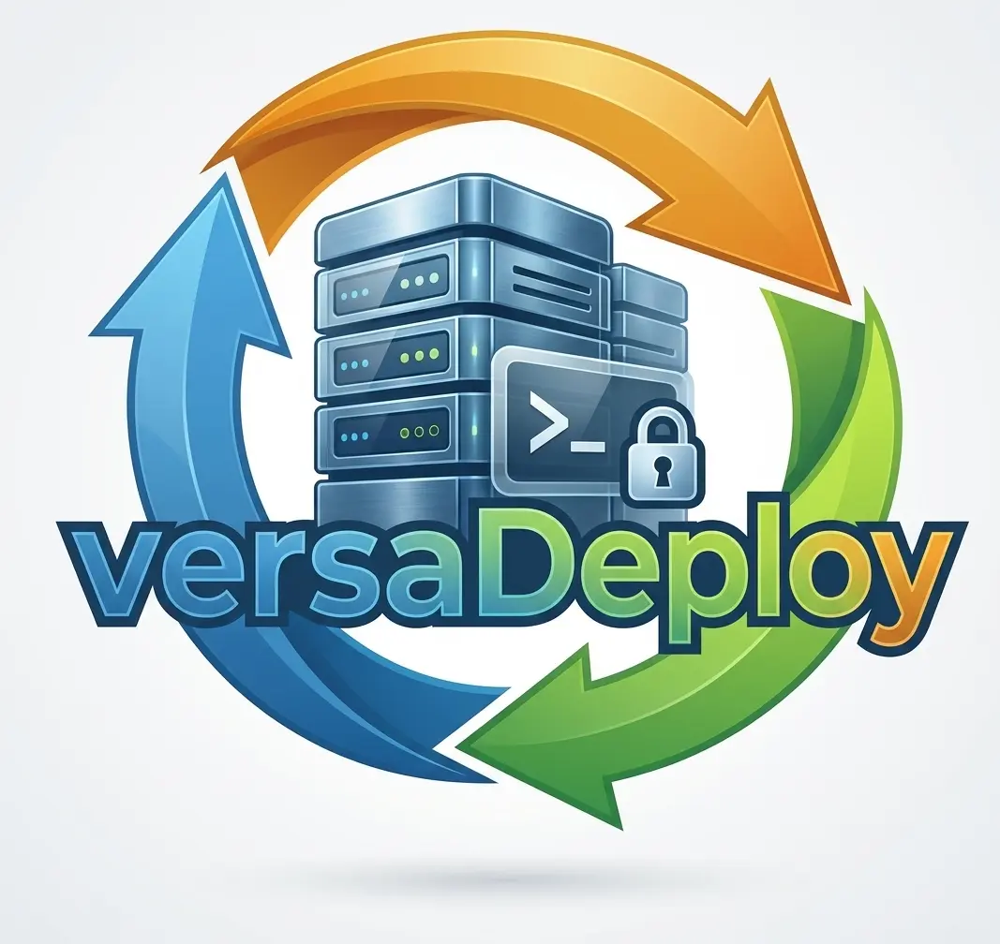

<div class="hero" markdown>


# versaDeploy

Atomic deploys to your Linux VPS, over SSH, with no agent.<br>
PHP, Node, Python and Go. Free and open source (MIT).

[Getting started](start.md){ .md-button .md-button--primary } [Watch the videos](videos.md){ .md-button } [GitHub](https://github.com/kriollo/versaDeploy){ .md-button }
</div>

<video controls preload="metadata" src="https://github.com/kriollo/versaDeploy/releases/download/media/00-intro.mp4">
  <track kind="captions" src="/media/00-intro.vtt" srclang="es" label="Español" default>
</video>

*The videos are in Spanish, with Spanish captions.*

```bash
curl -fsSL https://raw.githubusercontent.com/kriollo/versaDeploy/main/install.sh | sh
versa deploy production
```

<div class="grid cards" markdown>

-   :material-lightning-bolt: **Zero downtime**

    Every deploy is a new folder, switched on by changing a symlink. If a migration, a service or the health check fails, it rolls back to the previous release by itself.

-   :material-upload: **Uploads only what changed**

    Builds on your machine (composer, npm, Go) and compares every file by SHA256. `vendor`, `node_modules` and virtualenvs are reused.

-   :material-server: **Sets up the server**

    The Services view installs nginx or Apache, PHP-FPM or FrankenPHP, PostgreSQL or MariaDB, Redis, Node, Python, SSL, fail2ban, backups and cron. Without breaking what's already there.

-   :material-console: **All from the terminal**

    One interface to browse releases, edit the server's `.env`, read logs, open a remote terminal and roll back.

-   :material-shield-check: **Secure by default**

    No agent on the server, its SSH host key is verified, secrets never leave it, and updates are checked with sha256.

-   :material-account-group: **For teams and CI**

    A history of every deploy, production only from tags, notifications to Slack, Discord, Teams or Telegram, and a ready GitHub Actions workflow.

</div>

## Works with

**Frameworks:** Laravel, versaWYS and any PHP app with Composer · Next.js, Nuxt and Node · FastAPI, Flask and Django · Go (Gin and others) · Vite SPAs.
**Servers:** Ubuntu, Debian, Rocky Linux, AlmaLinux and RHEL (stack installation); deploys work even on old servers like CentOS 5.

How does it compare with Forge, Deployer, Kamal or Coolify? See the [comparison](compare.md).
