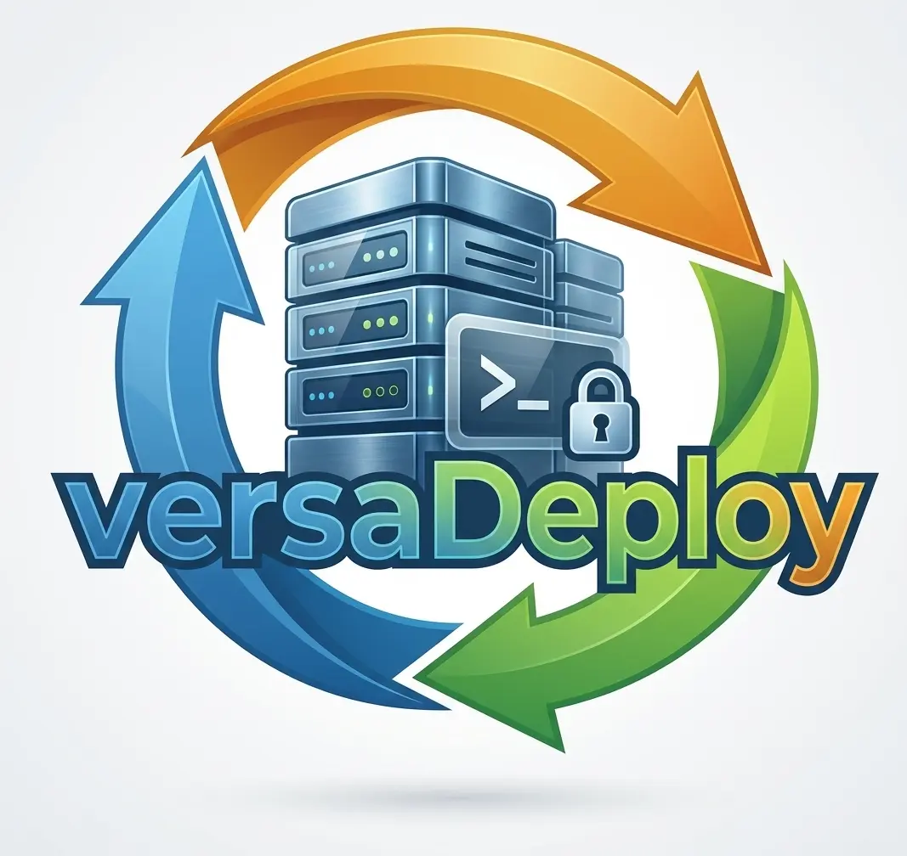

<div class="hero" markdown>


# versaDeploy

Deploys atómicos a tu VPS Linux, por SSH y sin agentes.<br>
PHP, Node, Python y Go. Gratis y open source (MIT).

[Primeros pasos](start.md){ .md-button .md-button--primary } [Ver los videos](videos.md){ .md-button } [GitHub](https://github.com/kriollo/versaDeploy){ .md-button }
</div>

<video controls preload="metadata" src="https://github.com/kriollo/versaDeploy/releases/download/media/00-intro.mp4">
  <track kind="captions" src="/media/00-intro.vtt" srclang="es" label="Español" default>
</video>

```bash
curl -fsSL https://raw.githubusercontent.com/kriollo/versaDeploy/main/install.sh | sh
versa deploy production
```

<div class="grid cards" markdown>

-   :material-lightning-bolt: **Cero downtime**

    Cada deploy es una carpeta nueva; se activa cambiando un enlace simbólico. Si una migración, un servicio o el health check fallan, vuelve solo a la versión anterior.

-   :material-upload: **Solo sube lo que cambió**

    Compila en tu computador (composer, npm, Go) y compara cada archivo con SHA256. `vendor`, `node_modules` y los virtualenv se reutilizan.

-   :material-server: **Prepara el servidor**

    La vista Services instala nginx o Apache, PHP-FPM o FrankenPHP, PostgreSQL o MariaDB, Redis, Node, Python, SSL, fail2ban, backups y cron. Sin romper lo que ya existe.

-   :material-console: **Todo desde la terminal**

    Una interfaz para ver releases, editar el `.env` del servidor, revisar logs, abrir una terminal remota y hacer rollback.

-   :material-shield-check: **Seguro por defecto**

    Sin agentes en el servidor, verifica su llave SSH, los secretos nunca salen de él, y las actualizaciones se verifican con sha256.

-   :material-account-group: **Para equipos y CI**

    Historial de cada deploy, producción solo desde tags, avisos a Slack, Discord, Teams o Telegram, y GitHub Actions listo para usar.

</div>

## Funciona con

**Frameworks:** Laravel, versaWYS y cualquier app PHP con Composer · Next.js, Nuxt y Node · FastAPI, Flask y Django · Go (Gin y otros) · SPA con Vite.
**Servidores:** Ubuntu, Debian, Rocky Linux, AlmaLinux y RHEL (instalación del stack); los deploys funcionan incluso en servidores antiguos como CentOS 5.

¿Cómo se compara con Forge, Deployer, Kamal o Coolify? Mira la [comparación](compare.md).
